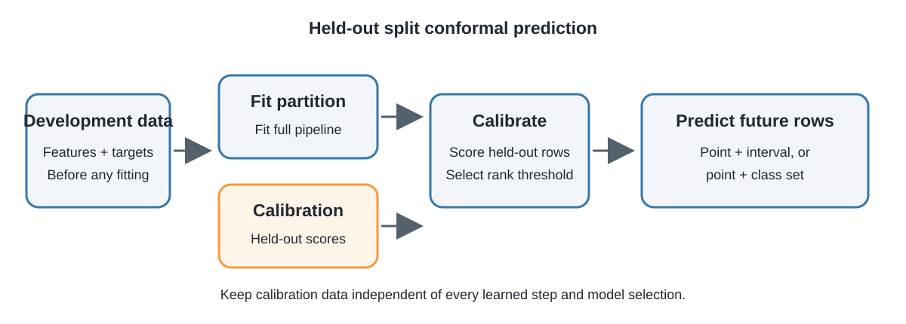
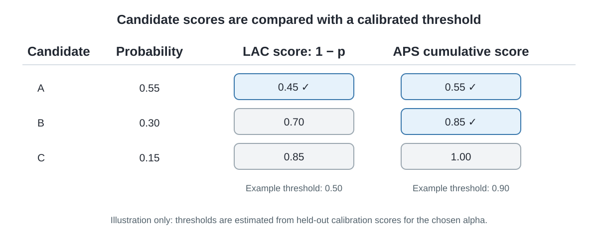

# Examples gallery

Browse the visual examples below for a quick introduction to split calibration, classification scores, regression intervals and set diagnostics. Select an image to open it at full size. The diagrams explain the workflow and score rules; the plots use held-out synthetic data.

## How calibration works

  <article class="visual-card">
    <h3>Split before fitting</h3>
    
For the usual split-conformal guarantee, hold calibration rows out before fitting learned preprocessing or a model. Automatic splitting handles this when the wrapper encloses the complete pipeline.

    
  </article>
  <article class="visual-card">
    <h3>Scores determine set membership</h3>
    
LAC and deterministic APS assign candidate scores differently. A calibrated threshold selects candidates whose score is at or below it. This example uses illustrative thresholds.

    
  </article>

## What prediction regions look like

  <article class="visual-card">
    <h3>Symmetric and asymmetric regression intervals</h3>
    
Both panels use the same training, calibration and test partitions. The asymmetric method can use different lower and upper corrections; neither method changes its correction from row to row.

    
  </article>
  <article class="visual-card">
    <h3>Classification set size and empirical coverage</h3>
    
Point size in the feature plot indicates the number of labels in each prediction set. The other panels show set-size counts and observed coverage by true class. Class-wise bars are descriptive and do not imply class-conditional guarantees.

    
  </article>

## Run the visual examples

The diagrams are static. Reproduce the data-driven figures with the [downloadable plotting script](plots.md), or follow the [regression](regression.md) and [classification](classification.md) workflows. Matplotlib is optional; see [installation](../installation.md). For the complete list of hands-on examples, see the [runnable examples index](index.md).
