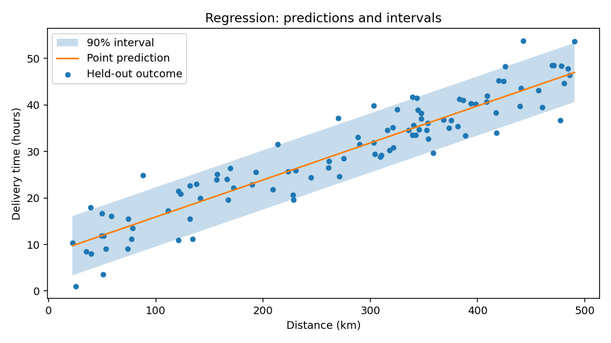

# Visual examples

[Download the runnable Python example](downloads/plots.py). It creates a regression interval plot and a classification prediction set plot from reproducible synthetic data. Matplotlib is optional; see [installation](../installation.md).

## Regression intervals

The first plot compares held-out outcomes with point predictions and 90% conformal intervals. The wrapper encloses the complete estimator; automatic calibration occurs before the estimator is fitted.

## Classification prediction sets

The second plot shows held-out samples by true class, with marker size indicating the number of candidate labels in each prediction set. A companion bar chart shows how often each set size occurs. A set mask is membership data; its entries are not probabilities.

```python
"""Create regression interval and classification prediction set plots."""

import matplotlib

matplotlib.use("Agg")
import matplotlib.pyplot as plt
import numpy as np
from sklearn.datasets import make_classification
from sklearn.linear_model import LinearRegression, LogisticRegression
from sklearn.model_selection import train_test_split
from sklearn.pipeline import Pipeline
from sklearn.preprocessing import StandardScaler

from conformity import ConformalClassifier, ConformalRegressor

# Regression: held-out outcomes, point predictions, and 90% intervals.
rng = np.random.default_rng(31)
X = rng.uniform(20, 500, size=(500, 1))
y = 8 + 0.08 * X[:, 0] + rng.normal(0, 4, 500)
X_dev, X_test, y_dev, y_test = train_test_split(X, y, test_size=0.2, random_state=32)
regressor = ConformalRegressor(LinearRegression(), tts_kwargs={"random_state": 33}).fit(
    X_dev, y_dev
)
order = np.argsort(X_test[:, 0])
x = X_test[order, 0]
points, intervals = regressor.predict(X_test[order], alpha=0.1, return_interval=True)

fig, ax = plt.subplots(figsize=(8, 4.5))
ax.fill_between(x, intervals[:, 0], intervals[:, 1], alpha=0.25, label="90% interval")
ax.plot(x, points, color="C1", label="Point prediction")
ax.scatter(x, y_test[order], s=18, color="C0", label="Held-out outcome")
ax.set(
    xlabel="Distance (km)",
    ylabel="Delivery time (hours)",
    title="Regression: predictions and intervals",
)
ax.legend()
fig.tight_layout()
fig.savefig("regression-intervals.png", dpi=140)
assert intervals.shape == (100, 2)
plt.close(fig)

# Classification: set size in feature space and set size counts.
X, y = make_classification(
    n_samples=900,
    n_features=2,
    n_redundant=0,
    n_informative=2,
    n_classes=3,
    n_clusters_per_class=1,
    class_sep=1.4,
    random_state=41,
)
X_dev, X_test, y_dev, y_test = train_test_split(
    X, y, test_size=0.25, random_state=42, stratify=y
)
classifier = ConformalClassifier(
    Pipeline(
        [
            ("scale", StandardScaler()),
            ("classifier", LogisticRegression(max_iter=500)),
        ]
    ),
    method="lac",
    tts_kwargs={"random_state": 43},
).fit(X_dev, y_dev)
membership, _ = classifier.predict(X_test, alpha=0.1, return_set=True)
set_sizes = membership.sum(axis=1)
counts = np.bincount(set_sizes, minlength=len(classifier.classes_) + 1)

fig, (scatter_ax, count_ax) = plt.subplots(1, 2, figsize=(9, 4))
for label, name in enumerate(("Class 0", "Class 1", "Class 2")):
    selected = y_test == label
    scatter_ax.scatter(
        X_test[selected, 0],
        X_test[selected, 1],
        s=24 + 28 * set_sizes[selected],
        alpha=0.7,
        label=name,
    )
scatter_ax.set(
    xlabel="Feature 1", ylabel="Feature 2", title="Held-out samples by true class"
)
scatter_ax.legend(title="Marker size = set size", fontsize=8)
sizes = np.arange(len(counts))
count_ax.bar(sizes, counts, color="C2")
count_ax.set(
    xticks=sizes,
    xlabel="Candidate labels in set",
    ylabel="Held-out samples",
    title="Prediction set sizes",
)
fig.tight_layout()
fig.savefig("classification-prediction-sets.png", dpi=140)
assert membership.shape == (225, 3)
assert counts.sum() == len(X_test)
plt.close(fig)
```




<!-- BEGIN EXAMPLE OUTPUT -->

```text
```

<!-- END EXAMPLE OUTPUT -->

The regression band shows marginal uncertainty for the target population; its fixed width does not describe conditional coverage at every distance. In the classification plot, larger markers have more plausible labels and call for review. The count chart summarizes ambiguity; `classifier.evaluate` also reports coverage and mean set size on held-out data.

## Next steps

Try the [regression workflow](regression.md), [classification review](classification.md), and [cross-validation example](cross-validation.md). Plots help diagnose a fitted workflow; they do not establish conditional coverage or justify tuning on the final test set.
