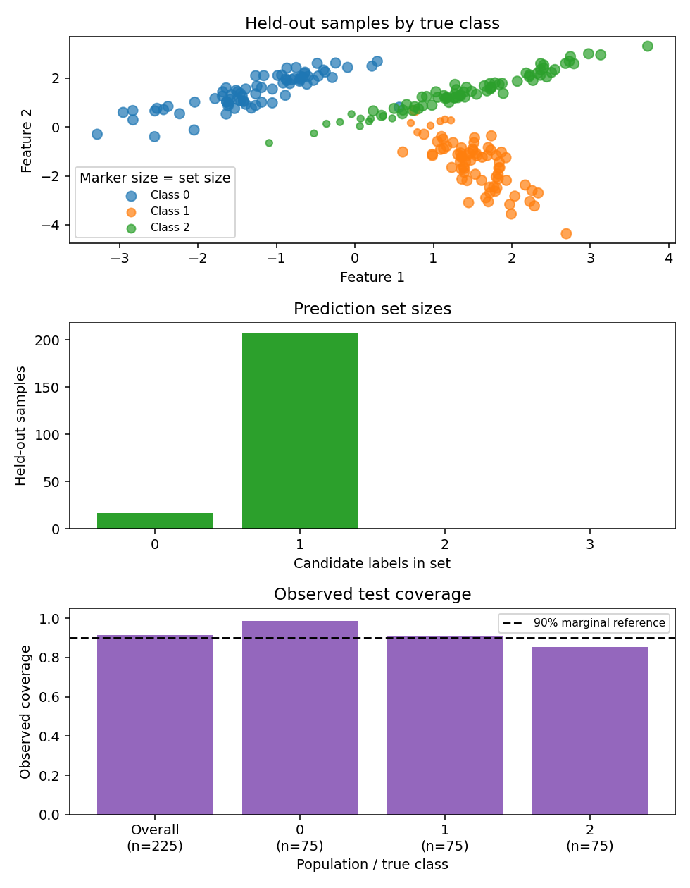

# Visual examples

[Download the runnable Python example](downloads/plots.py). It creates a regression interval plot and a classification prediction set plot from reproducible synthetic data. Matplotlib is optional; see [installation](../installation.md).

## Regression intervals

The first plot compares held-out outcomes with point predictions and 90% conformal intervals. The wrapper encloses the complete estimator; automatic calibration occurs before the estimator is fitted.

## Classification prediction sets

The second plot shows held-out samples by true class, with marker size indicating the number of candidate labels in each prediction set. A companion bar chart shows how often each set size occurs. A set mask is membership data; its entries are not probabilities.

```python
"""Create regression interval and classification prediction set plots."""

import matplotlib

matplotlib.use("Agg")
import matplotlib.pyplot as plt
import numpy as np
from sklearn.datasets import make_classification
from sklearn.linear_model import LinearRegression, LogisticRegression
from sklearn.model_selection import train_test_split, ShuffleSplit
from sklearn.pipeline import Pipeline
from sklearn.preprocessing import StandardScaler

from conformity import (
    ConformalClassifier,
    ConformalRegressor,
    prediction_set_coverage,
    prediction_set_coverage_by_class,
)

# Compare symmetric and asymmetric intervals using identical data partitions.
rng = np.random.default_rng(31)
X = rng.uniform(20, 500, size=(500, 1))
y = 8 + 0.08 * X[:, 0] + rng.exponential(4, 500) - 4
X_dev, X_test, y_dev, y_test = train_test_split(X, y, test_size=0.2, random_state=32)
X_train, X_calib, y_train, y_calib = train_test_split(
    X_dev, y_dev, test_size=0.25, random_state=33
)
order = np.argsort(X_test[:, 0])
x = X_test[order, 0]
fig, axes = plt.subplots(2, 1, figsize=(7, 8), sharey=True)
for ax, method, title in zip(
    axes,
    ("symmetric", "asymmetric"),
    ("Symmetric: one cutoff", "Asymmetric: separate tail cutoffs"),
):
    regressor = ConformalRegressor(
        LinearRegression(), auto_calibrate=False, interval_method=method
    )
    regressor.fit(X_train, y_train)
    regressor.calibrate(X_calib, y_calib)
    points, intervals = regressor.predict(
        X_test[order], alpha=0.1, return_interval=True
    )
    report = regressor.evaluate(X_test, y_test, alpha=0.1)
    print(
        f"{method}: coverage={report['coverage']:.3f}, "
        f"lower_miss={report['lower_miss_rate']:.3f}, "
        f"upper_miss={report['upper_miss_rate']:.3f}, "
        f"mean_width={report['mean_width']:.2f}, "
        f"normalized_width={report['normalized_mean_width']:.2f}, "
        f"interval_score={report['interval_score']:.2f}"
    )
    ax.fill_between(
        x, intervals[:, 0], intervals[:, 1], alpha=0.25, label="90% interval"
    )
    ax.plot(x, points, color="C1", label="Point prediction")
    ax.scatter(x, y_test[order], s=16, color="C0", label="Held-out outcome")
    ax.set(xlabel="Distance (km)", title=title)
    ax.legend(fontsize=8)
axes[0].set_ylabel("Delivery time (hours)")
fig.tight_layout()
fig.savefig("symmetric-asymmetric-intervals.png", dpi=140)
assert points.shape == (100,)
plt.close(fig)

# Classification: set size in feature space and set size counts.
X, y = make_classification(
    n_samples=900,
    n_features=2,
    n_redundant=0,
    n_informative=2,
    n_classes=3,
    n_clusters_per_class=1,
    class_sep=1.4,
    random_state=41,
)
X_dev, X_test, y_dev, y_test = train_test_split(
    X, y, test_size=0.25, random_state=42, stratify=y
)
classifier = ConformalClassifier(
    Pipeline(
        [
            ("scale", StandardScaler()),
            ("classifier", LogisticRegression(max_iter=500)),
        ]
    ),
    method="lac",
    calibration_splitter=ShuffleSplit(n_splits=1, test_size=0.2, random_state=43),
).fit(X_dev, y_dev)
membership, _ = classifier.predict(X_test, alpha=0.1, return_set=True)
set_sizes = membership.sum(axis=1)
counts = np.bincount(set_sizes, minlength=len(classifier.classes_) + 1)
coverage_by_class = prediction_set_coverage_by_class(
    y_test, membership, classes=classifier.classes_
)
overall_coverage = prediction_set_coverage(
    y_test, membership, classes=classifier.classes_
)
print(f"classification: marginal test coverage={overall_coverage:.3f}")
for label in classifier.classes_:
    class_count = int(np.sum(y_test == label))
    print(
        f"class {label}: observed coverage={coverage_by_class[label]:.3f} "
        f"(n={class_count})"
    )

fig, (scatter_ax, count_ax, coverage_ax) = plt.subplots(3, 1, figsize=(7, 9))
for label, name in enumerate(("Class 0", "Class 1", "Class 2")):
    selected = y_test == label
    scatter_ax.scatter(
        X_test[selected, 0],
        X_test[selected, 1],
        s=24 + 28 * set_sizes[selected],
        alpha=0.7,
        label=name,
    )
scatter_ax.set(
    xlabel="Feature 1", ylabel="Feature 2", title="Held-out samples by true class"
)
scatter_ax.legend(title="Marker size = set size", fontsize=8)
sizes = np.arange(len(counts))
count_ax.bar(sizes, counts, color="C2")
count_ax.set(
    xticks=sizes,
    xlabel="Candidate labels in set",
    ylabel="Held-out samples",
    title="Prediction set sizes",
)
class_labels = [
    f"Overall\n(n={len(y_test)})",
    *[f"{label}\n(n={np.sum(y_test == label)})" for label in classifier.classes_],
]
class_rates = [
    overall_coverage,
    *[coverage_by_class[label] for label in classifier.classes_],
]
coverage_ax.bar(class_labels, class_rates, color="C4")
coverage_ax.axhline(0.9, color="black", linestyle="--", label="90% marginal reference")
coverage_ax.set(
    ylim=(0, 1.05),
    xlabel="Population / true class",
    ylabel="Observed coverage",
    title="Observed test coverage",
)
coverage_ax.legend(fontsize=8)
fig.tight_layout()
fig.savefig("classification-prediction-sets.png", dpi=140)
assert membership.shape == (225, 3)
assert counts.sum() == len(X_test)
plt.close(fig)
```




<!-- BEGIN EXAMPLE OUTPUT -->

```text
symmetric: coverage=0.880, lower_miss=0.000, upper_miss=0.120, mean_width=8.73, normalized_width=0.49, interval_score=23.32
asymmetric: coverage=0.870, lower_miss=0.030, upper_miss=0.100, mean_width=11.66, normalized_width=0.66, interval_score=18.62
classification: marginal test coverage=0.916
class 0: observed coverage=0.987 (n=75)
class 1: observed coverage=0.907 (n=75)
class 2: observed coverage=0.853 (n=75)
```

<!-- END EXAMPLE OUTPUT -->

Both regression methods use identical fit, calibration and test partitions. The symmetric method uses one absolute-residual cutoff on both sides; the asymmetric method learns separate lower and upper corrections with equal tail allocation. The skewed synthetic noise makes that difference visible. Neither method estimates conditional coverage by distance. For asymmetric regression, compare the lower and upper miss rates with `alpha / 2` as empirical diagnostics, alongside width and interval score. The normalized width divides by the test-target IQR; the example also reports MAE, R² and MSE through `evaluate`, so point accuracy stays visible beside interval size.

In the classification plot, larger markers have more plausible labels and call for review. The chart and printed output show overall test coverage alongside each class's rate and sample count. Here the overall rate exceeds 90% while the third class (label `2`) is below it. That does not contradict the guarantee: the marginal guarantee averages over classes and inputs and is a probability over calibration and a fresh observation, not a promise that every finite test batch reaches 90%. The dashed line is a visual reference only; the default method does not guarantee 90% within each class. `classifier.evaluate` also reports overall coverage and mean set size on held-out data.

## Next steps

Try the [regression workflow](regression.md), [classification review](classification.md), and [cross-validation example](cross-validation.md). Plots help diagnose a fitted workflow; they do not establish conditional coverage or justify tuning on the final test set.
