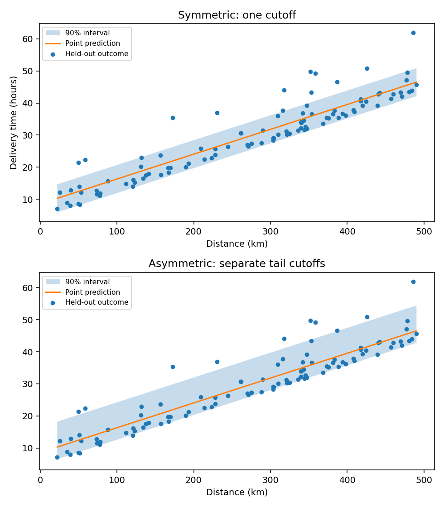
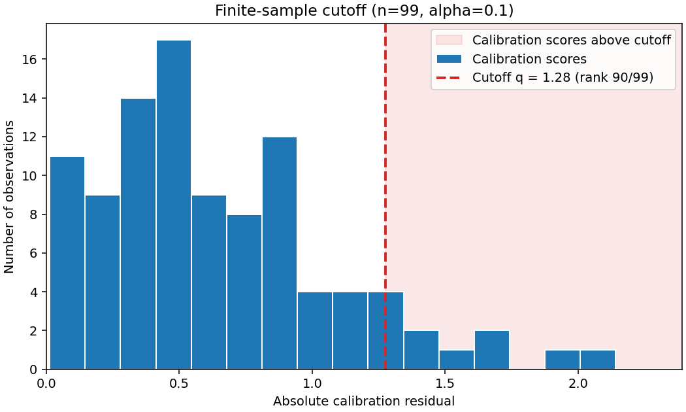

# The theory behind conformal prediction

## What problem does conformal prediction solve?

Imagine a robot guessing an answer. We check how wrong it was on examples it did not learn from, then make a “maybe zone” big enough to catch the right answer as often as our chosen target says, if new examples are like the old ones.

A regression model usually returns one number, and a classifier usually returns one label. Neither answer tells you how much uncertainty remains about the next outcome. A prediction interval or a set of plausible labels can make that uncertainty useful for a decision.

Conformal prediction constructs a **prediction region** around a model's output using observed prediction errors. You choose a miscoverage rate, $\alpha$, such as 0.1 for a 90% coverage target. Under the assumptions below, the region contains the outcome of a fresh observation with probability at least $1-\alpha$.

This is a guarantee about the prediction procedure across calibration and future observations. It is not a posterior probability that a particular observed interval contains its target. The package implements **split conformal prediction**, which fits a model once and calibrates its scores on a separate held-out partition.

## Intuition: compare the next error with errors you have seen

Imagine fitting a model on one dataset and measuring its errors on a second dataset that it has never used for learning. If the next observation behaves like those held-out observations, its error should have no special position among their errors.

That rank symmetry is the central idea. Conformal prediction chooses a threshold large enough that an unusually large future error occurs at most an $\alpha$ fraction of the time. It does not require normally distributed errors or a correctly specified regression function. A poor model can still produce valid regions under the assumptions, but those regions may be too wide or contain too many labels to help.

## Three data roles

| Partition | Purpose | What it must stay independent of |
| --- | --- | --- |
| Training and model development | Learn preprocessing, choose features and settings, fit the predictor | Final calibration and test outcomes |
| Calibration | Measure held-out scores and set the conformal threshold | Fitting and selection of the score function |
| Test | Evaluate coverage, width, set size and decision usefulness | Learning and final calibration |

Let $\hat f$ denote the fitted model, including every learned preprocessing step. Once calibration starts, this score-producing procedure must be fixed. With a wrapper on the final model, hold out calibration data before fitting the pipeline, then transform calibration features with the fitted preprocessing steps. For automatic calibration, wrapping the whole pipeline lets Conformity split before fitting its scaler. An outer learned scaler that sees the internal calibration rows does not meet this standard split-conformal argument. See [estimator and pipeline placement](user-guide/estimators.md).

## Nonconformity scores

A **nonconformity score** $S(x,y)$ measures how poorly a candidate outcome $y$ agrees with the fitted model at input $x$. Larger scores mean worse agreement. Compute the same score at calibration and prediction time.

### Regression: absolute residuals

For numeric outcomes, Conformity uses

$$
S(x,y) = |y-\hat f(x)|.
$$

Given a calibrated threshold $q$, all candidate outcomes whose residual is at most $q$ form the interval

$$
C_\alpha(x) = [\hat f(x)-q,\ \hat f(x)+q].
$$

The model determines the center; held-out errors determine the radius. This is the default `interval_method="symmetric"`: it produces symmetric intervals with the same width for all inputs at a fixed alpha. The optional `interval_method="asymmetric"` calibrates each side separately using the signed residuals

$$
S_{\mathrm{lower}}(x,y)=\hat f(x)-y,
\qquad
S_{\mathrm{upper}}(x,y)=y-\hat f(x).
$$

For each side, use the split-conformal corrected rank at miscoverage $\alpha/2$, and clip a negative correction to zero. The resulting interval is $[\hat f(x)-q_{\mathrm{lower}},\ \hat f(x)+q_{\mathrm{upper}}]$. Each one-sided event has miscoverage at most $\alpha/2$ by the finite-sample rank argument; the union bound therefore gives the interval marginal coverage of at least $1-\alpha$. No symmetry assumption on residuals is needed. The two corrections are constant across inputs, so this handles directional residual imbalance but does not adapt width to changing noise across the feature space. The finite correction requirement is $\alpha\geq 2/(n+1)$ for the asymmetric method. See [regression intervals](user-guide/regression.md).

The asymmetric method has a tradeoff. Separate corrections can make a region more useful when residual errors are directionally unbalanced: one side can extend farther than the other instead of widening both sides equally. It does not guarantee a shorter interval. The total width is $q_{\mathrm{lower}}+q_{\mathrm{upper}}$, which may be either smaller or larger than the symmetric width $2q$. Both corrections remain fixed across inputs, so asymmetric intervals do not adapt to feature-dependent noise. Since each tail uses a more extreme $\alpha/2$ rank, a small calibration set is more likely to require infinite bounds. Compare methods on independent test data at the same alpha, using coverage together with width and interval score.



*The plot compares the two constructions on the same held-out data. Asymmetry changes the allocation of interval width between tails; it does not promise narrower intervals or conditional coverage.*

### Classification: LAC and deterministic APS

For class probabilities $\hat p_y(x)$, LAC uses

$$
S_{\mathrm{LAC}}(x,y) = 1-\hat p_y(x).
$$

A label remains in the prediction set when its score is at most $q$. This gives a held-out calibrated probability cutoff; the probabilities themselves need not be perfectly calibrated for the rank argument. Probability quality affects how useful the resulting sets are.

For deterministic APS, order classes by decreasing predicted probability, breaking ties in fitted `classes_` order. If candidate $y$ has rank $r(y)$ in that ordering, its score is

$$
S_{\mathrm{APS}}(x,y) = \sum_{j=1}^{r(y)} \hat p_{\pi_j}(x).
$$

Here $\pi_j$ is the label at position $j$. Conformity includes candidates with cumulative score at most $q$. This is a deterministic variant: it does not implement randomized APS or automatically include the first class crossing the threshold. Empty sets are possible. The fitted class universe must include all possible future labels. See [classification sets](user-guide/classification.md).

## The finite-sample correction

For $n$ calibration observations, compute their true-outcome scores $s_1,\ldots,s_n$ and sort them as $s_{(1)}\le\cdots\le s_{(n)}$. For a fixed $0<\alpha<1$, choose

$$
k = \lceil (n+1)(1-\alpha) \rceil,
\qquad
q =
\begin{cases}
s_{(k)}, & k\le n,\\
+\infty, & k=n+1.
\end{cases}
$$

The prediction region is

$$
C_\alpha(x) = \{y : S(x,y)\le q\}.
$$

The plot below shows a calibration-score distribution and the selected cutoff. It uses synthetic absolute residuals so the calculation is easy to reproduce:

```python
import matplotlib.pyplot as plt
import numpy as np

rng = np.random.default_rng(42)
n = 99
alpha = 0.1
calibration_scores = np.abs(rng.normal(size=n))
rank = int(np.ceil((n + 1) * (1 - alpha)))
threshold = float(np.sort(calibration_scores)[rank - 1])

fig, ax = plt.subplots(figsize=(7.5, 4.5), constrained_layout=True)
right_edge = float(calibration_scores.max()) + 0.25
ax.axvspan(
    threshold,
    right_edge,
    color="C3",
    alpha=0.10,
    label="Calibration scores above cutoff",
)
ax.hist(
    calibration_scores,
    bins=16,
    color="C0",
    edgecolor="white",
    label="Calibration scores",
)
ax.axvline(
    threshold,
    color="C3",
    linestyle="--",
    linewidth=2,
    label=f"Cutoff q = {threshold:.2f} (rank {rank}/{n})",
)
ax.set(
    xlim=(0, right_edge),
    xlabel="Absolute calibration residual",
    ylabel="Number of observations",
    title=f"Finite-sample cutoff (n={n}, alpha={alpha})",
)
ax.legend()
fig.savefig("calibration-score-cutoff.png", dpi=140)
plt.close(fig)
```



Here $k=\lceil100\times0.90\rceil=90$, so the 90th sorted score is the cutoff. With distinct scores, 9 of the 99 calibration scores lie above it. The finite-sample coverage statement uses the rank among all $n+1$ scores, including the future score: the guarantee is at least $90/100=90\%$. It does not claim that exactly 90% of every future test batch will be covered.

The rank illustration can also be worked by hand. With $n=9$ and $\alpha=0.20$, $k=\lceil10\times0.80\rceil=8$, so the eighth sorted score is the cutoff. At $\alpha=0.05$, $k=\lceil10\times0.95\rceil=10$, outside the observed ranks; the threshold is infinite. The smallest alpha yielding a finite symmetric cutoff is $1/(n+1)$.

The correction uses **$n+1$**, because the future observation joins the $n$ calibration observations in the rank argument. A plain interpolated empirical quantile is not the same construction.

### A runnable threshold calculation

Question: how does a delivery-time model become a 90% prediction interval? We simulate 600 deliveries with distance and parcel weight as inputs and hours until delivery as the target. Two random splits reserve independent training, calibration and test observations. The fitted model learns only from training deliveries; calibration residuals determine the interval radius.

```python
import numpy as np
from sklearn.linear_model import LinearRegression
from sklearn.model_selection import train_test_split

from conformity import ConformalRegressor

rng = np.random.default_rng(12)
# Synthetic deliveries: distance in km and parcel weight in kg.
X = np.column_stack((rng.uniform(20, 500, 600), rng.uniform(0.5, 20, 600)))
y = 8 + 0.08 * X[:, 0] + 0.4 * X[:, 1] + rng.normal(0, 4, 600)

# Reserve 25% for final testing; split the remaining 75% into training/calibration.
X_dev, X_test, y_dev, y_test = train_test_split(X, y, test_size=0.25, random_state=13)
X_train, X_calib, y_train, y_calib = train_test_split(
    X_dev, y_dev, test_size=1 / 3, random_state=14
)

model = ConformalRegressor(LinearRegression(), auto_calibrate=False)
model.fit(X_train, y_train)

# These errors come from deliveries excluded from model fitting.
calibration_predictions = model.predict_point(X_calib)
scores = np.abs(y_calib - calibration_predictions)
alpha = 0.1
n = len(scores)
k = int(np.ceil((n + 1) * (1 - alpha)))
q = float(np.sort(scores)[k - 1]) if k <= n else np.inf

# Check that Conformity implements the same score and rank construction.
model.calibrate(X_calib, y_calib)
points, intervals = model.predict(X_test, alpha=alpha, return_interval=True)
manual_intervals = np.column_stack((points - q, points + q))
assert n == 150 and k == 136
np.testing.assert_allclose(model.calibration_scores_, scores)
np.testing.assert_allclose(intervals, manual_intervals)
assert model.q_level_ == q
report = model.evaluate(X_test, y_test, alpha=alpha)
print({"calibration_rows": n, "rank": k, "radius_hours": round(q, 2)})
print({"test_coverage": report["coverage"], "mean_width_hours": report["mean_width"]})
print("First test delivery: observed, predicted, lower, upper (hours)")
print(np.round([y_test[0], points[0], *intervals[0]], 1))
```

The two splits leave 300 training, 150 calibration and 150 test rows. `test_size=1/3` applies to the 450 development rows, so it reserves 150 for calibration. Fixed seeds make the example reproducible; neither split selects rows using their delivery outcomes. `auto_calibrate=False` tells the wrapper that we already manage the calibration partition.

With 150 calibration scores and `alpha=0.1`, the corrected rank is 136. The 136th sorted absolute error becomes the radius in hours. The assertions verify that manually applying the formula gives exactly the package's returned intervals. The output then compares the first unseen delivery's observed time, point prediction and bounds, and reports coverage over all test deliveries.

A radius of, for example, 6 hours would turn a 40-hour prediction into `[34, 46]`; the actual radius is computed from this example's held-out errors and printed by the code. Empirical test coverage can fall below 90% in a finite batch without contradicting the marginal theorem. Do not turn the observed test coverage into another tuning target.

For a very small calibration set, the rank can exceed the observed sample count: nine calibration scores at `alpha=0.05` require rank 10 and an infinite threshold. Conformity warns and returns unbounded regression intervals or all fitted classes for classification. Increase calibration size rather than clipping the rank to force finite output. Continue with [delivery decisions](examples/regression.md) to apply the interval to a 48-hour deadline.

## Why the coverage guarantee holds

Conditional on the training information, suppose the calibration observations and a fresh observation are **exchangeable**: their joint distribution is unchanged by permuting their order. Independent observations sampled from the same distribution with a value-independent split are a familiar sufficient case. Exchangeability is more general than independence.

Because the score function is fixed, their $n+1$ scores are exchangeable too. With distinct scores, the future true-outcome score has a uniformly distributed rank among positions 1 through $n+1$. The event that this rank is at most $k$ has probability $k/(n+1)$, and the threshold rule includes those outcomes. Therefore

$$
\Pr\{Y_{\mathrm{new}}\in C_\alpha(X_{\mathrm{new}})\}
\ge \frac{k}{n+1}
\ge 1-\alpha.
$$

For tied scores, independently break ties for the rank argument only. The implementation includes score equality, so ties can increase coverage. With almost surely distinct scores, coverage equals $k/(n+1)$; it need not equal the requested nominal level exactly.

The probability averages over calibration and the future observation, conditional on training under this assumption. It is not a guarantee conditional on the particular realized calibration sample.

## Marginal coverage and its limits

**Marginal coverage** averages over the population of future inputs and outcomes. It does not establish the stronger statement

$$
\Pr\{Y_{\mathrm{new}}\in C_\alpha(X_{\mathrm{new}})\mid X_{\mathrm{new}}=x\}
\ge 1-\alpha
\quad\text{for every }x.
$$

For example, a procedure can achieve 90% coverage overall while missing more often in a small subgroup. A singleton class set is not a 90% individual correctness guarantee. Reusing calibration for many predictions gives marginal guarantees for each fixed prediction procedure, not a promise that all predictions are covered simultaneously.

| Risk | Why the usual argument can fail | Practical response |
| --- | --- | --- |
| Calibration leakage | The score function depends on the scores used to calibrate it | Hold calibration out of all learned steps |
| Model or alpha selection using final calibration | The procedure is selected after seeing the errors | Select on development data, then use fresh calibration |
| Distribution shift | Future scores need not share the calibration rank distribution | Monitor drift; use methods justified for the new setting |
| Temporal or grouped dependence | The sampling scheme need not give exchangeability | Design validation for that dependence; ordinary random splitting is insufficient evidence |
| Missing future classes | A label outside `classes_` cannot enter a returned set | Establish the label universe; do not discard unknown-label calibration rows |

Training weights can change the model, and evaluation weights can change a reported diagnostic. Neither makes Conformity's calibration a weighted conformal procedure.

## Conformal p-values

For classification, the package also returns a tail-rank value for each candidate:

$$
p_{\mathrm{conf}}(x,y) =
\frac{1 + \sum_{i=1}^{n}\mathbf{1}\{s_i\ge S(x,y)\}}{n+1}.
$$

For the true label, these values are super-uniform under the same assumptions: the probability of a value at most $\alpha$ is at most $\alpha$. Inclusive ties make this conservative. In exact arithmetic, retaining candidates with $p_{\mathrm{conf}}(x,y)>\alpha$ agrees with the score-threshold set above. These values measure conformity with calibration scores; they are not posterior probabilities of class membership.

## Choosing a useful prediction region

Validity and usefulness are different questions. At comparable coverage, narrower regression intervals and smaller classification sets are usually more informative. Improving the fitted model can improve efficiency without changing the rank construction. Smaller alpha usually increases region size; it does not repair violated exchangeability assumptions.

## Split conformal prediction (inductive) and full conformal prediction (transductive)

There are many conformal methods. A basic distinction is between **split conformal prediction**, also called **inductive conformal prediction**, and **full conformal prediction**, also called **transductive conformal prediction**. Conformity currently implements split conformal prediction. Its automatic calibration API chooses one training/calibration split; `calibration_splitter` controls that split. Alternatively, set `auto_calibrate=False`, fit on training data, and call `calibrate` with a separate calibration set. See [calibration workflows](user-guide/calibration.md).

| | Split conformal prediction (implemented here) | Full conformal prediction (not implemented here) |
| --- | --- | --- |
| How the model is used | Fit once on the training partition; score the separate calibration partition | For each test input and candidate outcome, refit on the reference data plus that candidate, then score all augmented observations |
| Main tradeoff | Fast prediction, but some labeled data must be held out for calibration | Uses the labeled reference sample in every candidate check, but prediction can require many model fits |
| Prediction calculation | One calibrated score threshold produces the region | Include a candidate when its rank-based conformal p-value exceeds `alpha` |
| Coverage basis | Exchangeability of calibration observations and a fresh observation, conditional on the fitted model | Exchangeability of the full augmented sample and a score calculation that treats its rows symmetrically |

### How a full conformal predictor would work

For a new feature row $x_*$ and a candidate outcome $y_*$, append $(x_*,y_*)$ to the labeled reference data and fit a fresh clone of the estimator on the augmented sample. Compute one nonconformity score for each of its $n+1$ rows, including the candidate row. A conservative p-value is

$$
p(x_*,y_*) = \frac{1 + \sum_{i=1}^{n} \mathbf{1}\{s_i \geq s_*\}}{n+1},
$$

where $s_*$ is the candidate row's score and $s_i$ are the reference rows' scores under that same augmented fit. The prediction region contains candidates with $p(x_*,y_*) > \alpha$. The candidate label participates in fitting, so this is not the same as scoring a candidate with a fixed model. The rank argument requires the augmented score procedure to be permutation invariant; model fitting, row ordering, randomization and tie handling must preserve that symmetry.

Simply retraining once on all available labeled observations does not make a split-conformal model into a full-conformal one. If that includes the calibration observations, the model has now trained on the data used to set the old threshold, so that threshold no longer has the usual split-conformal justification. In full conformal prediction, refitting is repeated separately for each test-row/candidate-outcome pair, and every score, including the candidate's, is computed under that augmented fit.

In practice, a user would need to write a separate predictor around their estimator and score function. The following is Python-shaped pseudocode for classification; `score_rows` must compute the chosen nonconformity scores for every row under the same augmented fit:

```text
for x in X_test:
    prediction_set = []
    for candidate_label in classes:
        X_augmented, y_augmented = append_candidate(X_reference, y_reference, x, candidate_label)
        model = clone(estimator).fit(X_augmented, y_augmented)
        scores = score_rows(model, X_augmented, y_augmented)
        candidate_score = scores[-1]
        p_value = (1 + count(scores[:-1] >= candidate_score)) / len(scores)
        if p_value > alpha:
            prediction_set.append(candidate_label)
```

This is an algorithm sketch, not a Conformity method: `clone`, `append_candidate` and `score_rows` need to be supplied, and production code must handle ties and estimator randomness in a permutation-symmetric way. For split conformal, users do not need to write a new predictor: the supported automatic and manual workflows are documented in the [calibration guide](user-guide/calibration.md).

### What would change in Conformity

The current `BaseConformalPredictor` lifecycle fits once, stores held-out scores in `calibrate`, then answers queries using a cached threshold. Full conformal has no separate calibration-score array or one-time threshold, so it should use a separate predictor base or an explicit strategy with its own fit and prediction path. A full-conformal implementation would need to:

1. Store the labeled reference sample at fit time and clone the estimator for each candidate check.
2. Build the augmented data and refit for each test-row/candidate-outcome pair.
3. Compute comparable scores for every augmented row and derive the candidate's rank p-value.
4. Add tests that check row-order symmetry, inclusive tie handling, finite-sample coverage in exchangeable simulations, estimator cloning and fit counts.

Classification is the simplest first implementation: for each test row, evaluate each label in the finite fitted class list. With $m$ test rows and $K$ classes, this takes roughly $mK$ model fits. Regression outcomes form a continuous space, so evaluating a finite grid only approximates the prediction region and does not by itself preserve the exact coverage guarantee. Exact interval output needs an estimator-specific way to find the full set of accepted candidate values, including potentially disjoint regions. A generic full-regression API should wait until that search is specified.

### Is full conformal prediction used in practice?

Yes. Full conformal prediction is the original, principled construction and remains useful when datasets are small, model fitting is inexpensive, or keeping every labeled example in the reference sample matters. It also serves as a benchmark for methods that approximate its candidate-specific refits. Researchers have studied ways to approximate it at scale, including influence-function methods, because the direct procedure can be too costly for large models or many test inputs ([Guan, 2023](https://ojs.aaai.org/index.php/AAAI/article/view/25814)).

Using all available labeled examples in each candidate check can avoid reserving a separate calibration partition, but it does not guarantee narrower or more useful prediction regions than split conformal. The direct computation can be expensive, and approximations or shortcuts need their own analysis: a grid search over regression outcomes, for example, does not automatically inherit the exact full-conformal guarantee. For many production settings, split conformal is a practical choice because it calibrates once and predicts cheaply. Full conformal is a reasonable choice when its data-use benefit justifies its inference cost and the candidate search can be carried out with the required symmetry.

Both methods rely on exchangeability for their usual finite-sample marginal coverage result. Neither generally promises coverage conditional on each particular feature value or subgroup, and neither fixes distribution shift or temporal dependence by itself. Split conformal trades away some observations for a single fit and fast prediction. Full conformal avoids a fixed calibration holdout but can require one refit for every test-row/candidate pair; classifier cost is roughly the number of test rows times the number of classes. A finite grid over continuous regression outcomes only approximates the accepted region and does not automatically retain the exact guarantee. Other approaches such as CV+, jackknife+, conformalized quantile regression and weighted conformal prediction have their own algorithms and assumptions. None of those guarantees follows from the package's current split-conformal implementation. See [Lei et al.](https://arxiv.org/abs/1604.04173) for a formal comparison of full and split conformal regression.

Run the [regression](examples/regression.md) or [classification](examples/classification.md) example, then inspect [coverage and efficiency diagnostics](user-guide/diagnostics.md).

## Further reading

- [Lei et al., Distribution-Free Predictive Inference for Regression](https://arxiv.org/abs/1604.04173): regression prediction regions, finite-sample marginal coverage, and the tradeoffs between full and split conformal methods.
- [Romano, Sesia and Candès, Classification with Valid and Adaptive Coverage](https://papers.neurips.cc/paper_files/paper/2020/hash/244edd7e85dc81602b7615cd705545f5-Abstract.html): adaptive classification scores and the randomized procedure that differs from this package's deterministic APS variant.
